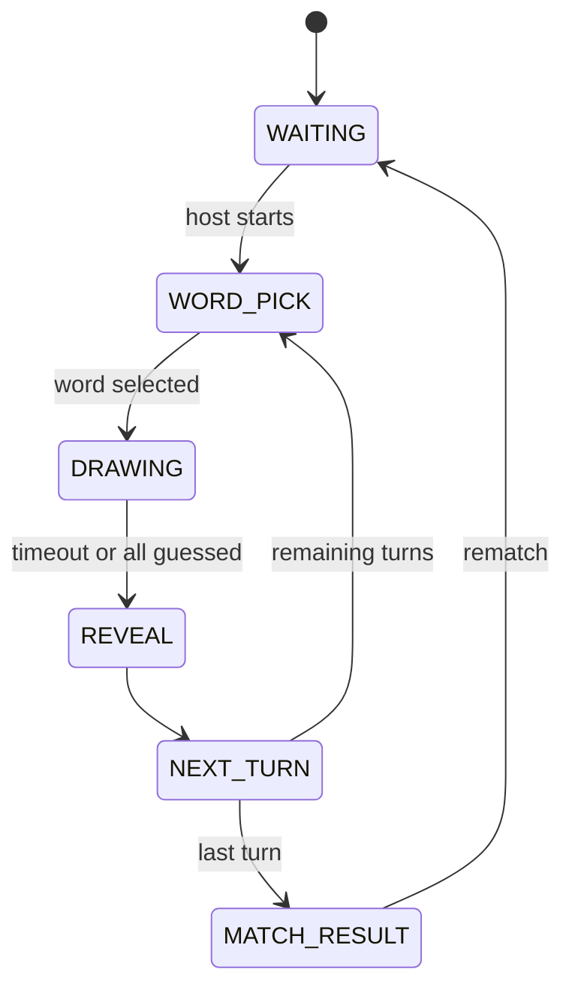
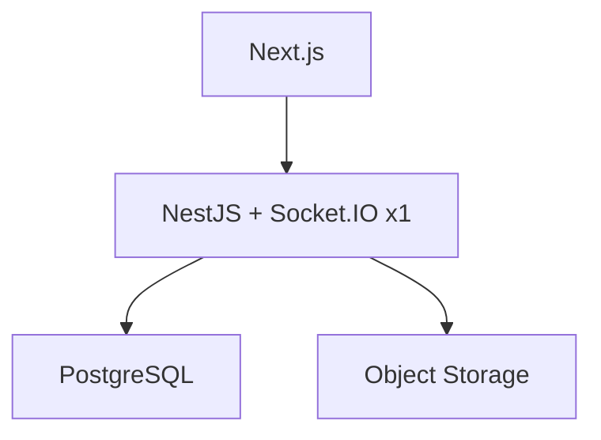
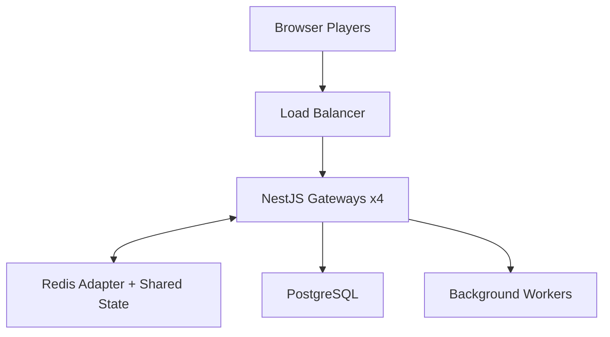

# DrawBattle Arena — Đặc tả toàn bộ chức năng Game A

**Loại:** Browser-first, mobile-first multiplayer drawing & guessing game.  
**Mục tiêu:** Một game vui, dễ chia sẻ với bạn bè ở Việt Nam, đồng thời đủ chiều sâu Backend Engineering từ Junior → Senior.  
**Người xây dựng:** Minh — Next.js, NestJS, PostgreSQL, Redis, Docker, ThinkPad P15 Gen 2 i7-11850H (8 nhân/16 luồng, 64 GB RAM).  
**Trạng thái:** Đề xuất thiết kế — chưa triển khai.  
**Ưu tiên:** Ra mắt trải nghiệm vui nhanh; chỉ mở rộng công nghệ sau khi đo được vấn đề.

## 0. Tầm nhìn và điểm khác biệt

**Pitch:** “Vẽ nhanh, đoán nhanh, cười cùng bạn bè — vào chơi trong vài giây bằng một đường link.”

Kết hợp hai vòng lặp sản phẩm:

1. **Live Arena:** 2–8 người vào phòng bằng link, thay phiên vẽ; những người còn lại đoán realtime.
2. **Challenge Link (asynchronous):** một người nhận từ khóa, vẽ 10–20 giây, gửi link; bạn bè có thể xem replay và đoán sau, không cần online cùng lúc.

**Lý do cần Challenge Link ngay từ đầu:** game multiplayer mới thường gặp vấn đề không có đủ người online cùng lúc. Một vòng chơi bất đồng bộ giúp trải nghiệm vẫn có ích ngay với lượng người dùng thấp.

**Các khác biệt đáng thử nghiệm:**

- Thử thách 10 giây “Vẽ xấu vẫn thắng”.
- Bộ từ khóa/câu đố hài hước về đời sống Việt Nam.
- Replay nét vẽ, tấm thẻ share kết quả.
- Các trò ngắn chạy tốt trên mobile.
- Về sau mới thêm chế độ đội, relay, sự kiện và daily challenge.

**Không hứa game sẽ viral:** các tính năng chia sẻ là giả thuyết sản phẩm; cần thử người dùng thật và đo retention/invite conversion.

## 1. Persona và vai trò

| Vai trò | Hành động |
|---|---|
| Guest | Đặt nickname, chơi, chia sẻ mà không cần tạo tài khoản |
| Registered Player | Đồng bộ lịch sử, thành tích, avatar, bạn bè |
| Room Host | Chọn luật, start trận, kick/mute, chuyển host |
| Drawer | Chọn từ, vẽ trong lượt, không được đoán từ của mình |
| Guesser | Nhìn canvas, nhập câu trả lời, theo dõi điểm |
| Spectator | Xem trận; không được can thiệp kết quả |
| Moderator | Xem report, hạn chế nội dung/tài khoản |
| Admin | Quản lý bộ từ, game flags, reports, analytics |

Guest token phải có vòng đời và cơ chế rejoin an toàn; nickname không được coi là định danh bảo mật.

## 2. Game modes — phạm vi theo phiên bản

| Mode | Tóm tắt | Ưu tiên |
|---|---|---|
| **Quick Challenge** | Vẽ từ khóa 10–20 giây → gửi link → bạn bè đoán | V1 |
| **Classic Live Room** | 2–8 người thay nhau vẽ, đoán realtime, tính điểm | V1 |
| **1v1 Duel** | Hai người chơi luân phiên, best-of-3 hoặc 5 | V2 |
| **Daily Draw** | Một thử thách chung mỗi ngày; share kết quả | V2 |
| **Speed Round** | 30–40 giây/lượt, tăng nhịp độ | V2 |
| **Team Battle** | Hai đội, điểm theo đội, thay phiên drawer | V3 |
| **Relay / Truyền Tin** | Câu gốc → tranh → câu đoán → tranh → xem kết quả | V3 |
| **Tournament** | Bracket 8/16 người, nhiều trận liên tiếp | V4 |
| **Custom Word Packs** | Người dùng tạo bộ từ riêng (có moderation) | V3 |
| **Spectator/Public Room** | Người xem, public discovery | V3, chỉ sau moderation |

Không cố làm tất cả modes cùng lúc. V1 phải chơi vui được với **một người** (Quick Challenge) và **một nhóm nhỏ** (Classic Live).

## 3. Gameplay chi tiết: Quick Challenge

1. Người A mở trang chủ → “Thách bạn bè”.
2. Đặt nickname Guest hoặc tiếp tục bằng tài khoản.
3. Chọn chủ đề: động vật, đồ ăn, trường học, công nghệ, meme Việt.
4. Server chọn một từ khóa có độ khó; **chỉ A nhận nội dung chính xác**.
5. A vẽ trong 10–20 giây (giới hạn được server kiểm soát).
6. Client gửi vector strokes theo chunk; server kiểm tra kích thước/số điểm, lưu replay.
7. Server phát challenge URL + preview không lộ đáp án.
8. A chia sẻ qua Messenger, Zalo, Threads, TikTok bio hoặc copy link.
9. Người B mở link → xem replay và nhập đáp án trong số lượt cho phép.
10. Server đánh giá chính xác, trả kết quả và lời mời tạo challenge mới.
11. Link có thể được nhiều người thử; chính sách công khai/riêng tư rõ ràng.

### 3.1 Luật Quick Challenge đề xuất

- Người vẽ: 15 giây mặc định; gói khó 10 giây.
- Người đoán: tối đa 3 lần thử; có countdown tùy mode.
- Điểm: số lần đoán ít hơn, thời gian ngắn hơn thì tốt hơn.
- Có thể bật “ẩn danh sách người đoán” để bảo vệ quyền riêng tư.
- Từ khóa chuẩn hóa Unicode, xử lý dấu tiếng Việt cẩn thận.
- Nếu từ có nhiều cách gọi, danh sách synonyms được biên tập trước.
- Tránh chấp nhận không dấu bừa bãi khi làm mất nghĩa.

### 3.2 Share card

- Tên challenge + ảnh/snapshot tranh hoặc video replay ngắn.
- Nội dung hấp dẫn nhưng **không lộ đáp án**.
- Nút “Bạn đoán được không?” và đường link.
- Open Graph preview phù hợp khi chia sẻ.
- Người vẽ quyết định có công khai tác phẩm hay không.
- Có report/delete challenge và thời hạn lưu.

## 4. Gameplay chi tiết: Classic Live Room

### 4.1 Tạo phòng

Host chọn:

- Tên phòng.
- Private/unlisted mặc định.
- Max players: 2–8 cho MVP.
- Số chu kỳ chơi: 1–3.
- Thời gian một lượt vẽ: 45/60/90 giây (mặc định 60).
- Word difficulty: Easy/Medium/Hard/Mixed.
- Language: Vietnamese đầu tiên.
- Chủ đề từ khóa.
- Bật/tắt hints.
- Bật/tắt guest access.
- Mật khẩu phòng (tùy chọn).
- Quyền người đến muộn: spectator hoặc chờ chu kỳ tiếp.
- Chế độ đơn giản (về sau custom scoring).

### 4.2 Lobby

- Tạo room code ngắn khó đoán.
- Link chia sẻ và QR code.
- Người tham gia đặt tên/avatar.
- Hiển thị player list, host badge, trạng thái ready.
- Host có thể kick/mute, thay đổi cấu hình trước trận.
- Guest không cần đăng ký.
- Chỉ host/role có quyền mới Start.
- Có thông báo người mới vào và người ngắt kết nối.
- Chủ phòng ngắt kết nối: auto-transfer host theo quy tắc xác định sau grace period.

### 4.3 Một trận diễn ra như thế nào?

Một **match** gồm `N` chu kỳ (mặc định 2). Mỗi player đủ điều kiện được vẽ một lần mỗi chu kỳ, theo thứ tự server xếp khi bắt đầu chu kỳ. Một **turn** gồm:

1. `WORD_PICK`: drawer được chọn 1/3 từ trong 10 giây.
2. `DRAWING`: drawer vẽ trong 60 giây; mọi người khác đoán.
3. `REVEAL`: công bố từ đúng, ai đoán được và điểm.
4. `TURN_RESULT`: xem nhanh kết quả và chuyển lượt.

Kết thúc `N` chu kỳ → `MATCH_RESULT`, bảng xếp hạng và nút “Chơi lại”.

### 4.4 Đoán từ

- Chat dùng chung nhưng **câu đoán hợp lệ** được kiểm tra phía server.
- Drawer không được gửi guess.
- Guesser đúng được khóa trạng thái correct; tiếp tục xem nhưng không farm điểm.
- Câu đoán đúng không broadcast nguyên đáp án cho người chưa đoán.
- Có thể hiển thị “Minh đã đoán đúng!” thay vì text.
- Guess sai xuất hiện trong chat theo policy.
- Limit số guesses/giây để tránh spam và brute force.
- Không cộng điểm khi turn hết hạn.
- Server xử lý thứ tự thời gian authoritative, không tin client timestamp.
- Với câu gần đúng, thông báo “gần đúng” chỉ khi tiêu chí thật sự rõ; MVP có thể bỏ tính năng này.

### 4.5 Hint

- Ở mốc 40% thời gian: hiển thị số chữ cái và khoảng trắng.
- Ở mốc 70%: hé lộ một ký tự theo quy tắc.
- Hint cố định theo server state; reconnect vẫn nhìn đúng.
- Nếu từ tiếng Việt có dấu, cách đếm grapheme/ký tự được định nghĩa rõ.
- Chế độ competitive có thể giảm điểm khi dùng hint.

### 4.6 Công thức tính điểm đề xuất

Ví dụ lượt 60 giây:

- Người đoán đúng nhận **60 + floor(100 × remainingTime / 60)**, tối đa 160.
- Người đầu tiên đoán đúng nhận bonus 20 (nếu không dùng hint).
- Drawer nhận 20 điểm cho mỗi người đoán đúng, tổng điểm drawer tối đa 100 mỗi lượt.
- Không được cộng điểm hai lần cho cùng player/turn.
- Khi disconnect, không tự thưởng điểm.
- Các hệ số sẽ điều chỉnh sau playtesting vì ảnh hưởng đến động lực game.

**Bất biến kỹ thuật:** toàn bộ điểm được tính và lưu ở server, việc gửi lại socket event không được cộng điểm lần hai.

### 4.7 Reconnect và leave

- Mất kết nối <15 giây: giữ slot và room state, cho rejoin bằng token.
- Mất kết nối lâu: đánh dấu offline; drawer bị skip/timeout theo policy.
- Guesser đến giữa turn: có thể spectate tới turn sau, tránh bất công.
- Host rời phòng: chọn người thay thế sau grace period.
- Room không có active players được cleanup theo TTL.
- Browser refresh không được nhân đôi player identity.
- Server restart: MVP có thể hủy trận với thông báo rõ; V2/V3 mới có room recovery theo snapshot và policy.

## 5. Drawing Canvas — danh sách chức năng

### V1 bắt buộc

- [ ] Mouse / touch / pen input qua Pointer Events.
- [ ] Pen, eraser.
- [ ] Bảng màu cơ bản (8–12 màu).
- [ ] Brush size: 3–5 mức.
- [ ] Clear canvas (chỉ drawer).
- [ ] Undo stroke.
- [ ] Hiển thị countdown.
- [ ] Render realtime người xem.
- [ ] Cùng kích thước logic canvas trên mobile/desktop.
- [ ] Responsive layout tránh che ô nhập guess.
- [ ] Chặn scroll trang khi người chơi đang vẽ bằng touch.
- [ ] Chỉ drawer hiện toolbar.

### V2/V3

- [ ] Redo.
- [ ] Brush styles/opacity (chỉ khi không ảnh hưởng fairness).
- [ ] Reconnection snapshot + các stroke còn thiếu.
- [ ] Replay tua nhanh.
- [ ] Xuất ảnh PNG.
- [ ] Video/GIF replay qua background job.
- [ ] Accessibility: nét và độ tương phản dễ phân biệt.
- [ ] Tự điều chỉnh chất lượng khi băng thông kém.

### Dữ liệu nét vẽ

Mỗi stroke gồm `strokeId`, `turnId`, `color`, `width`, `points[]` với tọa độ normalized trong [0,1]. Client batch điểm để giảm message; server validate kích thước payload, thứ tự và quyền drawer. Lưu các chunks theo thời gian để có thể replay; **không gửi một ảnh raster hoàn chỉnh cho mọi mousemove**.

Ví dụ event:

```json
{
  "event": "draw:strokeChunk",
  "roomId": "r123",
  "turnId": "t456",
  "strokeId": "s789",
  "seq": 14,
  "points": [{"x": 0.15, "y": 0.22}, {"x": 0.16, "y": 0.24}],
  "color": "#1F2937",
  "width": 4
}
```

## 6. Toàn bộ màn hình frontend

| Trang | Thành phần chính |
|---|---|
| Home | CTA chơi ngay, tạo phòng, thách bạn bè, daily |
| Guest entry | Nickname/avatar, không bắt đăng ký |
| Create room | Thông số trận, private room, password |
| Join room | Code/link, preview room, xử lý room full/expired |
| Lobby | Player list, ready, settings, invite, start |
| Live game | Canvas, drawer indicator, word/hints, chat, timer, scoreboard |
| Word selection | Ba từ, difficulty badges, timer chọn |
| Turn result | Đáp án, người đoán đúng, biến động điểm |
| Match result | Ranking, highlight, replay, play again, share |
| Challenge creator | Từ khóa, canvas 10–20 giây, tạo link |
| Challenge play | Xem replay, ô đoán, lượt đoán, kết quả |
| Daily challenge | Prompt mỗi ngày, streak, share card |
| Profile (V2) | Avatar, stats, wins, history |
| Leaderboard (V2) | Daily/weekly/all-time, anti-cheat |
| Word packs (V3) | Tạo, kiểm duyệt, chia sẻ bộ từ |
| Reports / Help | Báo cáo, blocked users, luật chơi |
| Admin (V3) | Moderation, analytics, word management |

## 7. Catalog chức năng kỹ thuật và sản phẩm

### A. Accounts & identity

- [ ] Guest sessions an toàn, nickname tạm.
- [ ] Optional account bằng email/social login (V2).
- [ ] Chuyển lịch sử Guest sang account nếu consent.
- [ ] Avatar mặc định; giới hạn upload ảnh nếu có.
- [ ] Profile privacy, delete account.
- [ ] Rate limit login/guest creation.
- [ ] Ban/suspension policy.
- [ ] Không cần account để vào phòng riêng.

### B. Room management

- [ ] Create/Join/Leave room.
- [ ] Room code và invite URL.
- [ ] Host/players/spectators.
- [ ] Room settings.
- [ ] Ready/start/kick/mute.
- [ ] Password (V2).
- [ ] Host transfer.
- [ ] Rejoin after refresh.
- [ ] Room expiry/cleanup.
- [ ] Public discovery (V3 + moderation).
- [ ] Matchmaking (V3).

### C. Realtime state

- [ ] Server-authoritative turn timer.
- [ ] Room presence.
- [ ] Player ready state.
- [ ] Game phase broadcasts.
- [ ] Draw stroke deltas.
- [ ] Chat guesses + correctness.
- [ ] Scoreboard.
- [ ] Rejoin snapshot.
- [ ] Sequence IDs, event de-duplication.
- [ ] Heartbeat/disconnect handling.
- [ ] Ack/retry cho game commands cần độ tin cậy.
- [ ] Không expose answer cho mọi client.

### D. Social / viral

- [ ] Copy invite link, QR code.
- [ ] Share challenge link.
- [ ] Rich OG preview.
- [ ] Share card sau trận.
- [ ] Replay clip/GIF (V2).
- [ ] “Thách lại” sau khi đoán.
- [ ] Daily challenge (V2).
- [ ] Streak (V2).
- [ ] Word packs theo trend (có kiểm duyệt).
- [ ] Kênh chia sẻ không ép permissions/contacts.
- [ ] Attribution code cơ bản, không theo dõi cá nhân vượt consent.

### E. Ranking / progression

- [ ] Điểm theo trận.
- [ ] Ranking cuối trận.
- [ ] MVP chỉ có local match ranking.
- [ ] Guest không được chiếm global ranking bền vững nếu không có cơ chế chống gian lận.
- [ ] Daily/weekly ranking (V2).
- [ ] Win rate, average guess time.
- [ ] Streak và badges (V2).
- [ ] Season ranking (V3).
- [ ] Anti-boost detection trước khi tặng reward.

### F. Content & moderation

- [ ] Từ khóa tiếng Việt có category/difficulty.
- [ ] Synonym dictionary được kiểm duyệt.
- [ ] Report drawing/chat/nickname.
- [ ] Profanity filter và mute.
- [ ] Host kick/ban trong room.
- [ ] Report review dashboard (V3).
- [ ] Takedown/delete replay.
- [ ] Không công khai user drawings mặc định.
- [ ] Rate limit để tránh spam room/challenges.
- [ ] Phòng private mặc định trong MVP.

## 8. Game state machine



**State transitions chỉ do server thực hiện.** Client có thể request “start”, “chooseWord”, “submitGuess” nhưng không tự phát state chính thức.

### Những invariant bắt buộc

1. Một room có tối đa một active turn.
2. Mỗi turn có đúng một drawer đã được server chọn.
3. Chỉ drawer được gửi stroke trong `DRAWING`.
4. Chỉ eligible guesser được submit guess.
5. Một player chỉ nhận correct-score một lần mỗi turn.
6. Câu trả lời bí mật chỉ tới đúng drawer, và tới mọi người sau `REVEAL`.
7. Timestamp authoritative là server time.
8. Match không chuyển phase hai lần khi timer/event race.
9. Event đến muộn của turn trước bị reject.
10. Snapshot khi reconnect không phá state hiện tại.

### Xử lý biên

- Tất cả người chơi đoán đúng trước timeout: kết thúc sớm sau delay ngắn.
- Drawer AFK: chọn từ mặc định, timeout nếu không vẽ.
- Chỉ còn một player: kết thúc/đóng phòng theo policy.
- Hai event `guess` tới cùng lúc gần hết giờ: thứ tự xử lý server quyết định.
- Server crash: V1 kết thúc room với thông báo; V3 room recovery khi được thiết kế/test đầy đủ.

## 9. API và Socket contracts

### REST endpoints minh họa

| HTTP | Endpoint | Mục đích |
|---|---|---|
| POST | /guest-sessions | Guest token |
| POST | /rooms | Tạo phòng |
| GET | /rooms/:code | Thông tin public room |
| POST | /rooms/:code/join | Cấp join token |
| POST | /challenges | Khởi tạo challenge |
| POST | /challenges/:id/finalize | Lưu tranh |
| GET | /challenges/:id | Metadata không lộ đáp án |
| POST | /challenges/:id/guesses | Người nhận link đoán |
| GET | /matches/:id/results | Kết quả theo quyền |
| GET | /me/matches | Lịch sử nếu có account |
| POST | /reports | Báo cáo nội dung |
| GET | /leaderboards | Ranking (V2) |

### Socket events client → server

- `room:join`, `room:leave`, `room:ready`.
- `match:start`, `match:rematch`.
- `turn:chooseWord`.
- `draw:strokeStart`, `draw:strokeChunk`, `draw:strokeEnd`, `draw:undo`, `draw:clear`.
- `guess:submit`.
- `chat:send`.
- `room:hostAction` (kick/mute/settings).
- `state:resync`.

### Socket events server → client

- `room:snapshot`, `room:playerJoined`, `room:playerLeft`.
- `room:hostChanged`.
- `match:phaseChanged`.
- `turn:youAreDrawer` (chỉ drawer, có từ khóa).
- `turn:publicState` (không có từ khóa).
- `draw:chunk`, `draw:reset`.
- `guess:accepted` / `guess:correct` / `guess:wrong` (cá nhân).
- `score:updated`.
- `turn:revealed`.
- `match:finished`.
- `error` với mã lỗi chuẩn.

**Contract metadata:** mọi event quan trọng có `roomId`, `matchId`, `turnId`, `requestId` và `serverSeq` khi cần. Socket ACK cho command, không gửi token bí mật vào log.

## 10. Data model

### Core entities

| Bảng | Trường quan trọng |
|---|---|
| users | id, nickname, email_nullable, avatar, created_at |
| guest_sessions | id, token_hash, expires_at, last_seen_at |
| rooms | id, code, host_player_id, visibility, settings_json, status, expires_at |
| room_players | id, room_id, user_id_nullable, guest_id_nullable, nickname_snapshot, role, joined_at |
| matches | id, room_id, status, rules_snapshot, started_at, ended_at |
| rounds | id, match_id, cycle_no, started_at, ended_at |
| turns | id, round_id, drawer_player_id, word_id, status, starts_at, ends_at, result_json |
| guesses | id, turn_id, player_id, guess_text, normalized_text, correct, received_at |
| scores | match_id, player_id, total_points, updated_at |
| word_entries | id, canonical_word, category_id, difficulty, synonyms_json, active |
| categories | id, slug, name |
| replays | id, turn_id_nullable, challenge_id_nullable, object_key, duration_ms, bytes |
| challenges | id, creator_guest_or_user, word_id, status, expires_at, replay_id |
| challenge_attempts | id, challenge_id, solver_guest_or_user, attempt_no, answer, correct, created_at |
| leaderboard_snapshots | period, rank, player_id, points, generated_at |
| reports | id, reporter_id_nullable, target_type, target_id, reason, status |
| moderation_actions | id, actor_id, target_type, target_id, action, created_at |

### Storage ownership

- **PostgreSQL:** users, history, match results, challenges, audit/reports, curated words.
- **Redis:** room presence, lobbies, currently active turn state, rate limits, short-lived reconnect data.
- **Object Storage:** vector replay/chunks, share image/GIF; private by default with signed access when needed.
- **Queue:** generate replay media, moderation/report notifications, background cleanup.

**MVP:** Có thể giữ room ephemeral state trong memory của một NestJS process và persist match result. Sau khi chức năng chuẩn, mới thêm Redis/multi-instance.

### Index/constraint gợi ý

- `rooms(code) UNIQUE`.
- `room_players(room_id, user_id)` hoặc guest ID theo chính sách.
- `guesses(turn_id, player_id, received_at)`.
- Unique correct-score transition bằng server-side state/DB constraint thích hợp.
- `challenges(expires_at)` cho cleanup.
- `matches(ended_at DESC)` cho lịch sử.
- `reports(status, created_at)` cho admin.
- Unique key cho event/game command chống gửi lặp nếu command tạo tác dụng phụ.

## 11. Kiến trúc chạy trên một máy, rồi scale

### V1 — đơn giản và có ích



V1 ưu tiên tính đúng đắn gameplay và trải nghiệm mobile, chưa thêm Kafka hoặc Kubernetes.

### V2/V3 — nhiều instances



- Redis Adapter giúp Socket.IO broadcast tới rooms trên nhiều gateways, nhưng **không tự lưu hoặc điều phối toàn bộ game state**.
- MVP room actor có một owner process; muốn scale nhiều nodes phải định nghĩa authoritative owner, routing hoặc shared state transition + concurrency control.
- Socket.IO long-polling với nhiều servers có thể cần sticky sessions; WebSocket-only thay đổi yêu cầu routing nhưng cần quản lý reconnect.
- Không tuyên bố multi-host HA từ thí nghiệm Docker Compose trên một ThinkPad.
- Đo CPU, P95 socket propagation, active sockets, room count, Redis traffic, DB connections.

## 12. Anti-cheat và fairness

- [ ] Server giữ từ khóa; không đưa đáp án vào broadcast/public HTML.
- [ ] Server xác nhận player đúng vai trò.
- [ ] Server timer và scoring authoritative.
- [ ] Rate-limit guesses, chat, strokes, challenge submits.
- [ ] Chặn duplicate correct-score.
- [ ] Validate stroke coordinates, payload bytes, brush size.
- [ ] Reject stale turn IDs.
- [ ] Không tin client “remainingTime”.
- [ ] Không cho client tự thay score.
- [ ] Restrict host action theo role.
- [ ] Guest identity rejoin có token, không dựa nickname.
- [ ] Handle collusion trong leaderboard bằng rules/heuristics; không hứa loại bỏ toàn bộ gian lận.
- [ ] Profanity filter, report/ban/mute.
- [ ] Kiểm duyệt custom word packs trước khi public.
- [ ] Privacy/retention controls.

## 13. Accessibility, mobile và performance

- [ ] Mobile-first, khung vẽ không bị keyboard che.
- [ ] Portrait/landscape layout.
- [ ] Canvas touch, mouse, stylus qua pointer API.
- [ ] UI đủ lớn cho ngón tay, không có button quá nhỏ.
- [ ] Light/dark mode tùy chọn.
- [ ] Reduced motion cho hiệu ứng.
- [ ] Hints không chỉ dựa vào màu.
- [ ] Âm thanh bật/tắt; không tự phát tiếng quá lớn.
- [ ] Hiển thị network/reconnecting indicator.
- [ ] Snapshot khi người chơi vào giữa game.
- [ ] Lược bớt animation trên mobile yếu.
- [ ] Client paint ngay stroke local để giảm cảm giác lag.
- [ ] Chỉ broadcast chunk sau throttle/batch, không mỗi pixel.
- [ ] Có hard limits cho số điểm/stroke và replay size.

## 14. Events & replay pipeline

1. Drawer tạo stroke.
2. Client vẽ locally và gửi chunks theo thứ tự.
3. Server kiểm tra room/turn/drawer/quota.
4. Server broadcast tới room, giữ replay buffer/snapshot.
5. Khi turn kết thúc, persist replay bền vững (không đánh mất do ack sớm).
6. Worker tùy chọn render GIF/MP4 hoặc ảnh share.
7. Share links chỉ cho nội dung được phép chia sẻ.
8. Retention cleanup job xóa nội dung hết hạn.

Hình ảnh do người chơi tạo có thể chứa dữ liệu nhạy cảm hoặc nội dung vi phạm; report/delete/privacy là tính năng sản phẩm, không phải chi tiết phụ.

## 15. Growth loop và đo lường

### Loop A — Share Challenge

```text
A chơi → A vẽ → A gửi link → B đoán → B nhận kết quả → B tạo thử thách mới → C nhận link
```

### Loop B — Live Room

```text
Host tạo room → 3 bạn vào → trận vui → share replay/ranking → bạn mới muốn tham gia trận tiếp
```

### Các metrics nên theo dõi

| Funnel | Metric |
|---|---|
| Landing | % click Play |
| Activation | % hoàn thành vòng đầu |
| Time to fun | Thời gian từ mở link đến vẽ/đoán |
| Share intent | % bấm Share |
| Share success proxy | % challenge có người nhận tham gia |
| Invite conversion | Người mở link → người chơi |
| Retention | D1, D7 theo privacy/consent |
| Game health | Lượt chơi hoàn tất, room abandonment |
| Performance | Join P95, stroke latency, error rate |
| Safety | Reports per 1000 sessions, enforcement time |

**Không coi raw clicks hoặc tổng pageviews là chứng cứ game viral.** Quan sát người dùng quay lại, rủ bạn bè và tiếp tục chơi. Nên phỏng vấn trực tiếp 10–20 người chơi đầu tiên.

## 16. Product testing và technical testing

### Playtesting

1. Người chưa biết game có hiểu cách chơi trong 20 giây?
2. Có ai tạo Challenge mới sau khi đoán xong?
3. Một trận 60 giây mỗi turn có quá dài trên điện thoại?
4. Người chơi có chủ động chia sẻ không?
5. Luật tính điểm có tạo cảm giác công bằng?
6. Tranh nét vẽ có khó đoán vì mobile canvas quá nhỏ?
7. Có hiện tượng người chơi bỏ đi khi phải chờ hết lượt?
8. Có cần thêm bot/sample challenge khi chưa đủ người?

### Functional E2E

- Guest creates challenge → sends link → friend guesses.
- Host creates room → 3 guests join → start → 1 cycle → final ranking.
- Viewer cannot draw or submit drawer-only events.
- Correct guess only scored once.
- Refresh/rejoin during DRAWING.
- Host leaves and host transfers.
- Timeouts at exact phase boundary.
- Room full/password invalid.
- Invalid word pack/replay input rejected.
- Report and delete shared replay.

### Fault injection

- Kill Socket.IO server while two users draw.
- Network disconnect for 15 seconds then reconnect.
- Delayed/out-of-order drawing chunks.
- Redis unavailable in multi-instance mode.
- Database temporarily unavailable.
- Player spams 100 guesses/sec.
- Two users submit correct guess near timeout.
- Time sync skew client/server.
- Replay queue duplicate job.
- One player repeatedly refreshes.

### Load tests

- 1/2/4/8 backend replicas (same machine).
- 10/100/500 live rooms simulated under bounded load.
- 2/4/8 users per room.
- Stroke events rate and draw batching.
- P95 join/guess ACK, round trip paint latency, CPU, RAM, Redis throughput.
- k6/Artillery/custom WebSocket clients as appropriate; generate load gradually.
- Event correctness is measured separately from throughput.
- Laptop 8 physical cores shared with load generator, so numbers are lab estimates.

## 17. Roadmap ưu tiên — 4 phases

### Phase 0 — Prototype & validation (3–7 ngày)

- [ ] Responsive landing + guest nickname.
- [ ] Canvas draw/undo/erase.
- [ ] Word set 100–200 từ được biên tập.
- [ ] Quick Challenge lưu/replay basic.
- [ ] Link để bạn bè đoán.
- [ ] Test với 10–20 người.
- [ ] Theo dõi funnel đơn giản.

**Exit:** người ngoài nhóm developer tự mở link, chơi và chia sẻ mà không cần hướng dẫn.

### Phase 1 — Public MVP (2–4 tuần)

- [ ] Guest experience polished.
- [ ] Quick Challenge hoàn thiện.
- [ ] Live private room 2–8 người.
- [ ] Ready/start, chọn từ, timer, canvas sync.
- [ ] Chat guesses, score, round/game results.
- [ ] Rejoin basic.
- [ ] Share links + OG previews.
- [ ] Report/mute/kick basic.
- [ ] PostgreSQL history, expiry cleanup.
- [ ] Unit/integration/E2E happy + edge tests.
- [ ] Deploy HTTPS, logs, error monitoring.

**Exit:** có thể chơi liên tục với nhóm bạn 15–30 phút không bị crash/hỏng state.

### Phase 2 — Retention & usability (3–6 tuần)

- [ ] 1v1 Duel, Speed Mode.
- [ ] Daily Draw.
- [ ] Player account optional/profile.
- [ ] Leaderboard & streak.
- [ ] Replay clip/GIF/background jobs.
- [ ] Ranking abuse controls.
- [ ] A/B test time limit/hints.
- [ ] Mobile performance polish.
- [ ] Moderation dashboard.

**Exit:** có dữ liệu người chơi quay lại và gửi challenge.

### Phase 3 — Backend Advanced (4–8+ tuần)

- [ ] Multi-instance Socket.IO.
- [ ] Redis adapter/shared room coordination.
- [ ] Deterministic room state machine.
- [ ] Owner failover/reconnect semantics.
- [ ] Load tests with realistic traffic.
- [ ] Metrics, traces, Grafana.
- [ ] Room state snapshots.
- [ ] Score/idempotency hardening.
- [ ] Reliable replay generation workers.
- [ ] Team/Relay modes nếu dữ liệu chứng minh nhu cầu.
- [ ] Capacity planning/ADR.

**Exit:** có báo cáo latency, failure recovery và scalability được đo.

## 18. Thứ tự code kỹ thuật đề xuất

1. **Game mechanics thuần TypeScript**: rules, phases, scoring, word validator. Unit test trước.
2. **Canvas component**: local draw/replay trên trình duyệt.
3. **Guest + challenge API**: chơi bất đồng bộ.
4. **Live game room**: Socket.IO một instance.
5. **PostgreSQL match/challenge persistence**.
6. **Mobile performance + UX**.
7. **Security/anti-cheat/moderation**.
8. **Redis/multi-instance** khi cần học scalability.
9. **Queues/background jobs** cho replay video/cleanup.
10. **Monitoring + load test**.

Không nên xây authentication, chat server, leaderboard toàn quốc, matchmaking, tournaments trước khi có gameplay đơn giản mà người dùng muốn quay lại.

## 19. Danh sách 30 bài lab Backend từ game

| ID | Lab | Kỹ thuật |
|---|---|---|
| 01 | Guess accepted once | Idempotency |
| 02 | Two guesses same millisecond | Concurrency |
| 03 | Server-authoritative timer | Time synchronization |
| 04 | 1000 fake guesses/sec | Rate limiting |
| 05 | Drawer event from spectator | Authorization |
| 06 | Refresh and reconnect | Session recovery |
| 07 | Room lifecycle tests | State machine |
| 08 | Canvas stroke batching | Networking/performance |
| 09 | Out-of-order stroke chunks | Event ordering |
| 10 | Vector replay size | Compression/storage |
| 11 | PostgreSQL leaderboard query | Indexing |
| 12 | 1 million fake match rows | EXPLAIN ANALYZE |
| 13 | Redis room TTL | Cache/state |
| 14 | Score update with transaction | Data correctness |
| 15 | Duplicate replay job | Idempotent workers |
| 16 | Render clips asynchronously | Queue |
| 17 | 1 → 2 → 4 → 8 gateways | Horizontal scaling |
| 18 | Players on different instances | Cross-node room events |
| 19 | Redis outage | Fault tolerance |
| 20 | Kill active room server | Recovery policy |
| 21 | DB pool saturation | Connection pools |
| 22 | Socket P95 latency histogram | Observability |
| 23 | Tracing guess → score write | Distributed tracing |
| 24 | Synthetic 500 rooms | Load testing |
| 25 | CPU throttling containers | Resource limits |
| 26 | Worker crash mid-GIF | Retry/recovery |
| 27 | Host disconnect | Distributed ownership |
| 28 | Moderation report flow | Security/audit |
| 29 | Rolling deployment during matches | Deployment strategy |
| 30 | ADR server state: memory vs Redis | System design trade-offs |

## 20. Release readiness / Definition of Done

### Gameplay release gate

- [ ] Một người mới chơi được Quick Challenge không hỏi cách sử dụng.
- [ ] 3 người chơi được full match ở Chrome desktop và Android/iOS browser.
- [ ] Tất cả điểm authoritative và đúng khi gửi event trùng.
- [ ] Đáp án không lộ trước reveal.
- [ ] Refresh/rejoin không tạo bản sao người chơi.
- [ ] Không ai được vẽ thay drawer.
- [ ] Có report/ban/mute tối thiểu.
- [ ] Server không crash nếu stroke/guess payload sai.
- [ ] Có chính sách lưu/xóa drawings và privacy.
- [ ] Có bản backup/tài liệu deploy.
- [ ] Monitor các lỗi nghiêm trọng.
- [ ] Phương án fallback khi quá tải: đóng nhận phòng mới hoặc queue admission.

### Portfolio release gate

- [ ] Demo video.
- [ ] Architecture diagrams V1 và V3.
- [ ] Database ERD.
- [ ] README chạy local.
- [ ] Integration tests.
- [ ] Load benchmark kèm hạn chế.
- [ ] Fault recovery demo.
- [ ] 3–5 ADR đáng giá.
- [ ] Screenshots cho mobile/desktop.
- [ ] Hướng dẫn làm thế nào người khác chơi thử.

## 21. Nội dung từ khóa tiếng Việt

Bắt đầu khoảng 100–200 từ/cụm từ được biên tập. Phân tầng:

- Easy: động vật, trái cây, đồ gia dụng, hoạt động.
- Medium: nghề nghiệp, phương tiện, địa điểm, món ăn.
- Hard: cụm từ dài/ngữ cảnh hài, cần diễn đạt bằng hình.
- Special: chủ đề lễ, Tết, trường học, công nghệ, trend khi đã xác minh và không vi phạm chính sách.

Mỗi entry có canonical answer, aliases, độ khó, ngôn ngữ, rating/mức an toàn, category, usage count. Theo dõi từ nào hay bị bỏ qua hoặc gây tranh cãi. Không dùng nội dung gây xúc phạm người thật hoặc công kích nhóm người làm lõi của “viral”.

## 22. Nguồn và ranh giới cảm hứng

- Skribbl.io (mô hình drawing/guessing rounds): https://skribbl.io/
- Gartic Phone (vẽ truyền tin): https://garticphone.com/
- Jackbox (room-code browser join): https://support.jackboxgames.com/hc/en-us/articles/15794759479959-How-do-I-join-a-game
- Socket.IO rooms: https://socket.io/docs/v4/rooms/
- Socket.IO Redis adapter: https://socket.io/docs/v4/redis-adapter
- MDN Pointer Events + canvas: https://developer.mozilla.org/en-US/docs/Web/API/Pointer_events/Using_Pointer_Events

**Không sao chép tên thương hiệu, artwork, từ khóa độc quyền, UI hoặc assets của các game khác.** Gameplay cần điểm khác biệt riêng và playtest trước khi đầu tư hạ tầng.

---

## 23. Bài đầu tiên nên làm ngay

**Bài 1: Quick Challenge không cần realtime**

Xây 4 màn hình Home → Draw → Share → Guess với 100 từ khóa tiếng Việt, 15 giây vẽ, lưu các stroke theo vector và link có hạn sử dụng. Không cần login, Redis hay Docker swarm để bắt đầu.

**Acceptance:** A dùng điện thoại tạo tranh, gửi link; B mở từ thiết bị khác và đoán được; kết quả lưu đúng; A không thể sửa tranh sau khi đã gửi; link hết hạn được xử lý; response không bao giờ lộ đáp án trước khi B đoán.

Nếu làm tốt vòng lặp này và thấy người dùng tự chia sẻ, hãy phát triển Live Arena.
