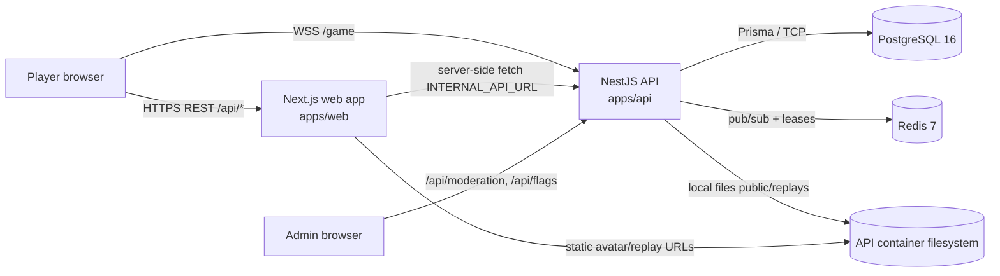

# HLD — High-Level Design

Scope: deployed system shape at commit `92b3e23`. See [README](./README.md) for conventions.

## 1. System context

Actors and entry points:

- **Guest player** — `POST /api/guest-sessions` returns an HS256 JWT (`type: guest`, `sub` = guest-session id, nickname in payload). The random session token hash is stored in `guest_sessions.token_hash`; the JWT itself is the client credential.
- **Registered player** — `POST /api/account/login` returns a `type: user` JWT. Role `ADMIN` unlocks `/api/moderation`, `/api/flags` writes, analytics summary and daily generation.
- **Room host** — the only player allowed to emit `match:start`, `match:rematch`, `room:updateSettings` and `room:hostAction`.
- **Socket identity** — resolved in `handleConnection` from `handshake.auth.token` or `Authorization: Bearer`, verified against the DB on every connect. Client-supplied nicknames at `room:join` are ignored; the verified token's nickname is authoritative.

## 2. Deployment topology

`docker-compose.yml` defines four services:

| Service | Image/build | Port | Notes |
| --- | --- | --- | --- |
| `postgres` | postgres:16-alpine | host 5440 → 5432 | named volume `pgdata`; health checked with `pg_isready`. |
| `redis` | redis:7-alpine | host 6390 → 6379 | named volume `redisdata`; health checked with `redis-cli ping`. |
| `api` | `apps/api/Dockerfile` | 3001 | `NODE_ENV=production`, `TRUST_PROXY` defaults to `0` (must be set to the trusted hop count behind a proxy), `JWT_SECRET` required at boot. |
| `web` | `apps/web/Dockerfile` | 3002 | `NEXT_PUBLIC_API_URL` (browser) and `INTERNAL_API_URL` (server-side) build args. |

There is **one API container in the shipped compose file**. The code contains partial multi-instance support (Redis adapter, room leases) but no load balancer, no shared media volume strategy beyond the single `media_data` mount, and no composition for scaling `api` horizontally. See [ADR-004](./adr/004-room-ownership-lease-vs-single-instance.md).

## 3. Component boundaries

### 3.1 Web (`apps/web`)

- `src/app/**` — Next.js App Router pages. The live game is a single client component at `src/app/room/[code]/page.tsx`.
- `src/lib/socket.ts` — singleton Socket.IO client for `/game`; enables reconnection with 1 s initial delay and up to 10 attempts. The token is captured at connect time; rotating tokens requires a fresh `connectSocket`.
- `src/lib/store.ts` — Zustand client store holding room snapshot, `myPlayerId`, phase, strokes, scores and chat.
- `src/components/canvas/DrawingCanvas.tsx` — local drawing surface; emits `draw:strokeChunk` events.
- `src/lib/api.ts` — REST wrapper used for identity, rooms, challenges, history and moderation screens.

The client re-emits `room:join` on every `connect`, and sends `state:resync` after 1.5 s if no snapshot has arrived. This is how a dropped WebSocket recovers its room membership.

### 3.2 API (`apps/api`)

NestJS app assembled in `src/app.module.ts`, global prefix `/api`, validation pipe with whitelist, CORS from `CORS_ORIGIN`, static assets from `public/`. Trusted-proxy handling is explicit in `src/main.ts` because HTTP throttle keys derive from `req.ip`.

| Module | Responsibility |
| --- | --- |
| `auth` | Guest and user JWT validation, guest session creation. |
| `account` | Registration, login, profile, avatar upload/link guest. |
| `room` | Room CRUD, join/leave persistence, bans, host pointer, password hashing. |
| `game` | **In-memory** match/turn state machine, scoring, hints, strokes, guesses, chat moderation; persists completed matches. |
| `socket` | Socket.IO gateway, Redis adapter wiring, room-ownership lease service. |
| `match`, `replay`, `challenge`, `daily`, `report`, `moderation`, `leaderboard`, `analytics`, `feature-flag`, `word` | REST-facing domain features. |
| `common` | Cleanup cron, profanity filters, HTTP throttle guard, admin guard. |

### 3.3 Shared (`packages/shared`)

`packages/shared/src` holds constants (`GAME_CONSTANTS`, mode configs), game rules (scoring, guess normalization, hint generation, stroke validation), DTO types (`types/game.ts`, `types/api.ts`, `types/socket-events.ts`) and validators. Both apps import from `@drawbattle/shared` so room codes, score formulas and event names cannot drift between client and server.

## 4. Data stores and ownership

### PostgreSQL — durable source of truth

Schema is in `apps/api/prisma/schema.prisma`. Key aggregates:

- **Identity** — `User`, `GuestSession`, `RoomBan`.
- **Rooms** — `Room` (unique 6-char code, JSON settings, status, expiry), `RoomPlayer` (soft delete via `leftAt`, unique per `(roomId,userId)` and `(roomId,guestSessionId)`, index on `(roomId,leftAt)`).
- **Matches** — `Match`, `Round`, `Turn`, `Guess`, `Score`, `Replay`. A whole match is written once at `endMatch` time.
- **Async content** — `Challenge`, `ChallengeAttempt`, `DailyChallenge`, `DailyChallengeAttempt`, `Word`, `Category`, `FeatureFlag`, `Report`, `ModerationAction`, `LeaderboardSnapshot`, `Streak`.

Room passwords are stored as unsalted `sha256("room-pwd:" + password)` in the room's JSON settings (`room.service.ts`); the plain value is removed before the settings are written and before any snapshot is emitted.

### Redis — two independent roles

1. **Socket.IO adapter** (`redis-adapter.service.ts`) — if `REDIS_URL` is set, two Redis clients are created and `@socket.io/redis-adapter` is installed. Failure to connect is logged and the API continues in **single-instance mode**. This only fans out emits; it does not replicate game state.
2. **Room-ownership lease** (`room-router.service.ts`) — `room:owner:<roomId>` with a 7200 s TTL, intended to declare which API instance owns a room. `claimRoom`, `getRoomOwner`, `isLocalRoom`, `refreshTTL` and `releaseRoom` exist, and `setRedis` is the injection point.

**Gap:** `RedisAdapterService` and `RoomRouterService` are not wired together. No code calls `setRedis`, `claimRoom`, `refreshTTL` or `releaseRoom`. The lease is dead infrastructure today; only the adapter is active (and only when `REDIS_URL` is present). Do not assume room affinity is enforced.

### Local filesystem — replay GIFs

`replay.worker.ts` renders GIFs in a `worker_threads` worker into `public/replays/<replayId>.gif` and records `/replays/<id>.gif` in the DB. `docker-compose.yml` mounts `media_data` at `/app/apps/api/public`, so the files survive container recreation on a single host but are not shared across hosts. Concurrency is capped at 3 in-process jobs plus a 5-minute cron sweeper; render timeout is 60 s.

## 5. Trust boundaries and authorization

| Boundary | Enforcement |
| --- | --- |
| Client → REST | Guards (`AuthGuard`, `GuestGuard`, `OptionalAuthGuard`, `AdminGuard`), DTO validation pipe, `@Throttle` guard keyed on authenticated identity or trusted `req.ip`. |
| Client → Socket | Token verification in `handleConnection`; room membership via socket.io room + `GameStateService` snapshot (`isActiveMember`); host checks in `GameStateService`. |
| Nickname | Derived from verified token at connect/join; profanity-validated at account/guest creation. Client `nickname` in `room:join` is ignored. |
| Room password | Verified in `RoomService.joinRoom` transaction, including reconnect path; only a boolean `hasPassword` and settings without secrets reach clients. |
| Room kick | `RoomBan` rows keyed by `(roomId,userId)` and `(roomId,guestSessionId)` checked authoritatively on every join; in-memory kicking is best-effort. |
| Draw/guess/chat | Drawer/turn-id/phase checks, in-memory per-player rate limits, payload validation, profanity filter/censor. |

**Known privacy gap:** `guess:submit` does not profanity-filter a *correct* guess. Wrong guesses are censored via `censorProfanity` when broadcast as chat; correct guesses only emit `guess:correct` (playerId, score), so no guess text leaks there.

## 6. Capacity and time constants

From `packages/shared/src/constants.ts`: 2–8 players (mode-dependent), 10 s word pick, 45–60 s drawing depending on mode, 5 s reveal, 20 guesses/turn, 500 ms guess rate limit, 1 s chat rate limit, 30 stroke chunks/s per socket, 15 s reconnect grace, 2 h room TTL, 24 h challenge TTL, 3 challenge attempts, 500 strokes/2000 points/64 KiB per stroke payload. `GAME_CONSTANTS` is shared code, not configuration — changing limits requires a deploy.

## 7. Capacity envelope (what the design can actually support)

- A single API process holds all live rooms in `Map`s. No sharding, no eviction of stale rooms except when the last player leaves and empty-room cleanup runs.
- `GameStateService` has one lock chain per room (`withLock`), so turns inside a room are serialized; different rooms proceed concurrently in the same event loop.
- Broadcasts fan out through the Socket.IO adapter if present. Redis pub/sub bandwidth and `MAX_STROKES_PER_TURN` (500) bound payload size per turn, but there is no per-room bandwidth cap.
- PostgreSQL serializes room joins with a `Serializable` transaction; the replay writer and cleanup jobs add background load.

See [load-test plan](./load-test.md) for the measurements needed before making a scale claim.
